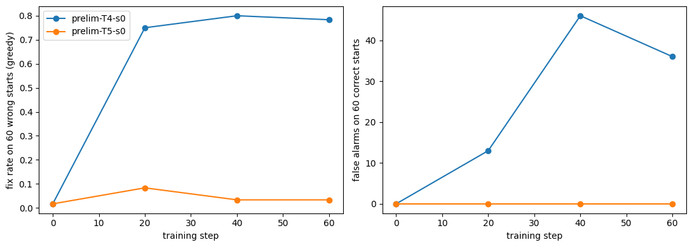

# Kaggle preliminary, 25 Nov 2026: T5 against T4

**Setup.** Qwen3-1.7B with a LoRA adapter (rank 32) on the fix task, thinking off. Each step takes 8 training starts from GSM8K train problems: 4 with a wrong step 2 and 4 with a correct one. It samples 8 answers per start at temperature 1, up to 320 new tokens, and 4 of the 8 continue after " Wait". Both runs use β = 4, learning rate 1e-4, gradient clipping at 1.0, seed 0 and 60 steps. T5 trains with trajectory balance, T4 with GRPO as usually run.

Evaluation uses the 60 GSM8K-SC test problems, each with a wrong and a correct start, at steps 0, 20, 40 and 60. Greedy answers run up to 400 new tokens, and each start also gets 4 sampled answers. The location test uses 20 GSM8K test problems at steps 0 and 60.

The runs went side by side on Kaggle's two T4s, one per GPU, with `PAIR=main bash scripts/kaggle_prelim.sh` at commit 21cc10e. The executed notebook is [`2026-11-25-kaggle-prelim-main.ipynb`](2026-11-25-kaggle-prelim-main.ipynb).

## Every evaluation

A false alarm is a correct start whose greedy continuation opens by calling the step wrong. "Clean right" counts correct starts that end with the right answer. The sampled columns use 4 answers per start.

| Run | Step | Fixed | False alarms | Clean right | Fix pass@4 | Fix vote@4 | Sampled fix rate | Sampled false alarms |
|---|---|---|---|---|---|---|---|---|
| T4, GRPO | 0 | 1/60 | 0/60 | 49/60 | 10.0% | 5.0% | 5.4% | 0.0% |
| T4, GRPO | 20 | 45/60 | 13/60 | 51/60 | 86.7% | 68.3% | 62.9% | 21.7% |
| T4, GRPO | 40 | 48/60 | 46/60 | 48/60 | 90.0% | 83.3% | 78.3% | 65.0% |
| T4, GRPO | 60 | 47/60 | 36/60 | 49/60 | 90.0% | 83.3% | 76.7% | 46.2% |
| T5, trajectory balance | 0 | 1/60 | 0/60 | 49/60 | 10.0% | 5.0% | 5.4% | 0.0% |
| T5, trajectory balance | 20 | 5/60 | 0/60 | 48/60 | 15.0% | 5.0% | 6.2% | 1.7% |
| T5, trajectory balance | 40 | 2/60 | 0/60 | 49/60 | 16.7% | 10.0% | 7.5% | 0.4% |
| T5, trajectory balance | 60 | 2/60 | 0/60 | 48/60 | 10.0% | 6.7% | 5.4% | 0.0% |

## Error moved to step 2, 3 or 4

Training only shows errors at step 2. Each cell gives greedy fixes, then the majority vote over 4 sampled answers, then false alarms.

| Run | Step | Error at step 2 | Error at step 3 | Error at step 4 |
|---|---|---|---|---|
| T4, GRPO | 0 | 1/20, 5%, 0/20 | 3/20, 15%, 0/20 | 2/20, 15%, 0/20 |
| T4, GRPO | 60 | 13/20, 70%, 12/20 | 12/20, 75%, 11/20 | 15/20, 80%, 9/20 |
| T5, trajectory balance | 0 | 1/20, 5%, 0/20 | 3/20, 15%, 0/20 | 2/20, 15%, 0/20 |
| T5, trajectory balance | 60 | 1/20, 15%, 0/20 | 3/20, 15%, 0/20 | 2/20, 15%, 0/20 |

No greedy continuation opened by approving the step ("That step is correct", "Yes") at any evaluation of either run.

## Progress

| Run | Steps | Drift from the untuned model at the end | Mean step time | Wall time |
|---|---|---|---|---|
| T4, GRPO | 60/60 | 49.07 | 268 s | 6 h 29 min |
| T5, trajectory balance | 60/60 | 1.28 | 252 s | 5 h 45 min |

Drift is the log-ratio of the trained model to the untuned model on the last training batch. Neither run hit its time limit.

## What the run shows

**GRPO learned to fix the planted error, and the habit carried over.** T4 went from 1/60 fixed to 45/60 by step 20 and 47/60 at step 60. With the error moved to step 3 or 4, which training never shows, it fixed 12/20 and 15/20, against 3/20 and 2/20 before training.

**GRPO also learned to doubt correct steps.** Its false alarms rose from 0/60 to 13/60 at step 20, 46/60 at step 40 and 36/60 at step 60. It still answered 49/60 correct starts right, the same as before training. It learned to re-check every step, not only wrong ones. The reward scores only the final answer, so doubting a correct step costs nothing as long as the answer stays right.

**Trajectory balance at β = 4 stayed close to the untuned model.** T5 fixed 5/60 at step 20 and 2/60 at step 60, and raised no false alarms. Its drift ended at 1.28, against 49.07 for T4. The zero false alarms come from not learning, not from selectivity.

**The anchor explains the flat run.** Trajectory balance trains toward π_ref × exp(β × reward). At β = 4, a rewarded answer can gain at most a factor e^4, about 55, over its probability under the untuned model. The drift penalty counts every token of the answer. The nudged answers begin with a forced " Wait" that the untuned model seldom produces on its own: it fixed 1 of 60 wrong starts greedily and 5.4% of sampled answers. Trajectory balance can therefore take up the nudged answers only so far. `docs/attacker-replies-test.md` predicted this limit.

**For the attacker-replies test, this points against the original hypothesis.** GRPO fed answers it did not write took them up far more than trajectory balance did. The same anchor would also limit an attacker's answers.

## Questions from `docs/kaggle-prelim.md`

1. Does T5 reach T4's fix rate with fewer false alarms? No. T5 raised fewer false alarms (0/60 against 36/60) but fixed 2/60 against 47/60.
2. Does T5 fix more wrong starts than T3 at step 20? Not answered yet: T3 and T2 run in the second session (`PAIR=own`).
3. With 4 tries, does trajectory balance fix more by majority vote than GRPO? No. Vote@4 at step 60 was 6.7% for T5 and 83.3% for T4. With the error at step 3 or 4, T4 reached 75% and 80%, and T5 stayed at 15%.

## Limits

- One seed. With 60 test problems, a difference below about 10 points cannot be told apart from noise. T4's false alarms moved from 46/60 to 36/60 between steps 40 and 60.
- The numbers come from the notebook's summary. The bundle with per-step logs (rewards, gradient norms) was not downloaded from Kaggle.
- Only β = 4 ran. Two runs would separate the explanations: T3 at β = 4 should stay flat like T5 if the anchor holds it, and T5 at a larger β shows whether trajectory balance learns once the anchor loosens.
